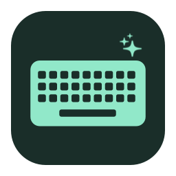
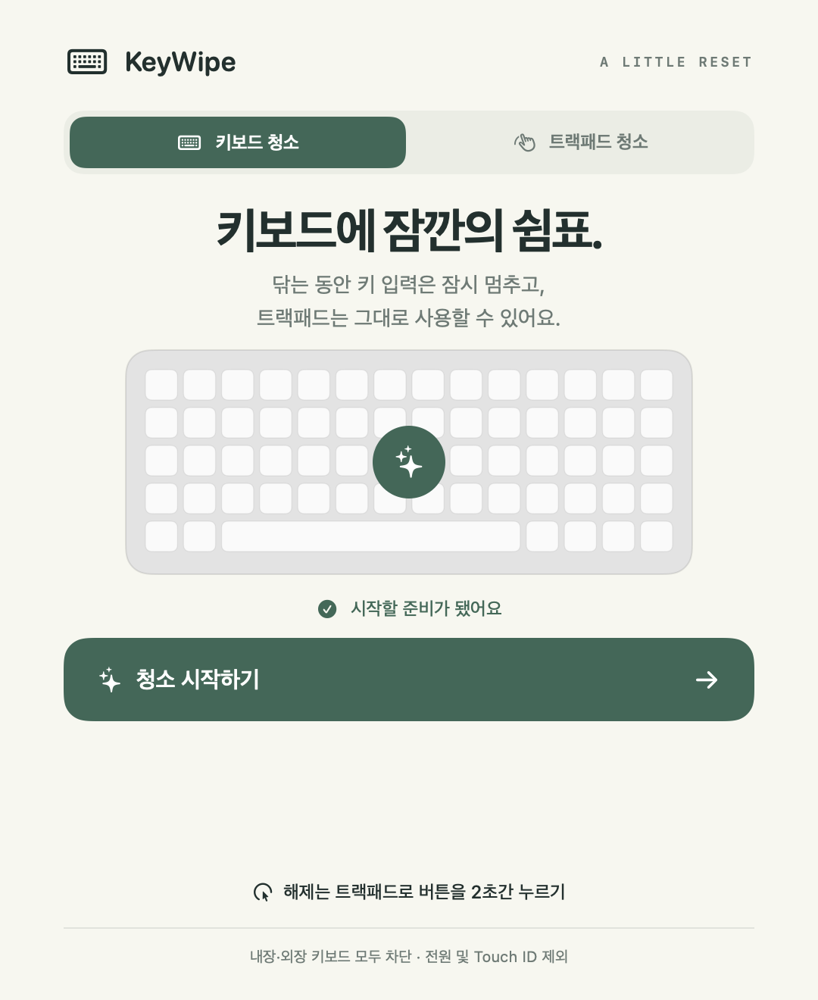
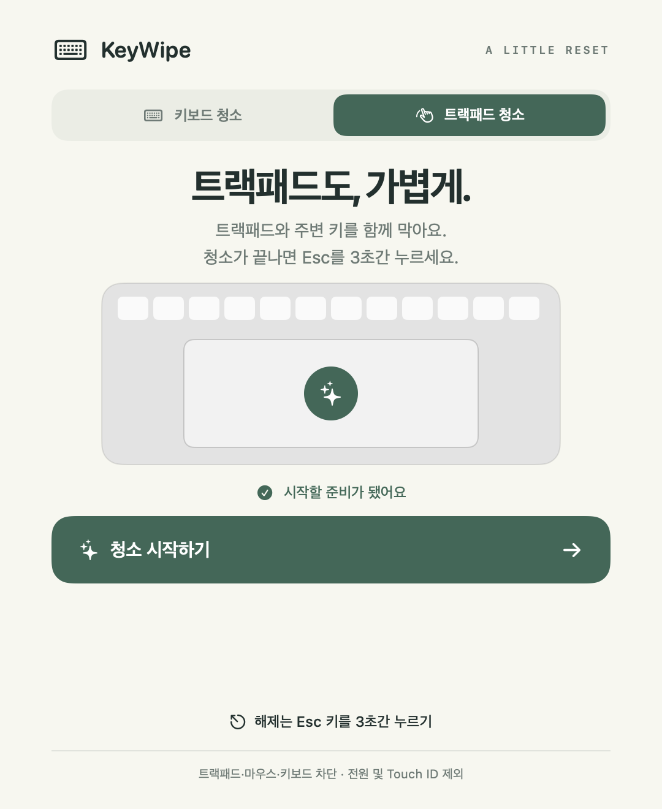

# KeyWipe

맥북 키보드와 트랙패드를 닦는 동안 실수로 입력되지 않게 해주는 작은 macOS 앱입니다.

[English](README.md) · [개발 안내](docs/DEVELOPMENT.md) · [MIT 라이선스](LICENSE)

[](https://github.com/mir-stream/keywipe/actions/workflows/ci.yml)

| 모드 | 차단 범위 | 해제 |
| --- | --- | --- |
| 키보드 청소 | 내장·외장 키보드. 트랙패드와 마우스는 사용 가능 | 화면 버튼을 **2초간 누른 뒤 놓기** |
| 트랙패드 청소 | 커서 이동, 클릭, 스크롤, 제스처 이벤트와 키보드 입력 | **Esc를 3초간 누른 뒤 놓기** |

트랙패드 모드는 외장 마우스도 함께 차단합니다. 짧게 누르면 해제 진행이 초기화되고, 해제 조건을 채워도 눌린 키나 클릭이 남아 있으면 모두 놓을 때까지 기다립니다.

<p>
  
  
</p>

## 다운로드와 설치

**[macOS용 KeyWipe 다운로드](https://github.com/mir-stream/keywipe/releases/latest/download/KeyWipe-macOS-universal.zip)** · [릴리스 안내](https://github.com/mir-stream/keywipe/releases/latest)

macOS 14 이상에서 사용할 수 있습니다. Apple Silicon과 Intel 실행 파일을 함께 담은 Universal 앱이며, Developer ID 서명과 Apple 공증을 적용했습니다.

1. `KeyWipe-macOS-universal.zip`을 내려받아 압축을 풉니다.
2. 실행 중인 KeyWipe가 있다면 종료하고, **KeyWipe.app**을 **응용 프로그램**으로 옮깁니다.
3. 앱을 열고 아래 안내에 따라 손쉬운 사용 권한을 허용합니다.

다운로드한 앱을 사용할 때는 Xcode나 서명 인증서가 필요 없습니다. 다운로드 파일과 함께 SHA-256 체크섬도 제공합니다.

## 소스에서 빌드하기

필요한 환경:

- macOS 14 이상.
- Swift 6 이상을 제공하는 Xcode 또는 Command Line Tools.
- `.app` 빌드에 사용할 키체인의 **Apple Development 서명 인증서**.

```sh
git clone https://github.com/mir-stream/keywipe.git
cd keywipe
bash scripts/build.sh
open dist/KeyWipe.app
```

Apple Development 서명 식별자가 하나면 자동으로 선택합니다. 여러 개라면 사용할 식별자를 지정합니다.

```sh
security find-identity -v -p codesigning
KEYWIPE_SIGNING_IDENTITY="Apple Development: Your Name (IDENTIFIER)" bash scripts/build.sh
```

업데이트할 때도 같은 인증서와 앱 식별자를 유지해야 합니다. macOS는 앱의 서명을 기준으로 권한을 관리하며, 임시 서명(ad-hoc)은 재빌드 때 앱의 식별 기준이 달라집니다. 권한 항목이 꼬이는 문제를 예방하기 위해 패키징 스크립트는 임시 서명을 허용하지 않습니다.

`swift test`와 `swift build`에는 인증서가 필요 없습니다. 실제 사용할 때는 권한이 터미널 대신 KeyWipe에 연결되도록 패키징한 `.app`을 실행하세요. 로컬 빌드와 배포 앱은 서명 종류가 다르므로 서로 바꿔 사용할 때 손쉬운 사용 권한을 다시 허용해야 할 수 있습니다.

## 처음 사용하기

1. **권한 설정 열기**를 누릅니다.
2. **시스템 설정 → 개인정보 보호 및 보안 → 손쉬운 사용**에서 **KeyWipe**를 켭니다. 목록에 없으면 `+`로 `dist/KeyWipe.app`을 추가합니다.
3. 앱으로 돌아와 모드를 고르고 **청소 시작하기**를 누릅니다.
4. 키보드 모드는 화면 버튼을 2초간, 트랙패드 모드는 Esc를 3초간 누른 뒤 놓아 해제합니다.

앱을 옮긴다면 최종 위치에서 권한을 부여하세요. 서명을 변경한 뒤 설정에서 허용해도 앱이 권한을 인식하지 못한다면, **기존 KeyWipe 항목을 삭제하고 현재 앱을 다시 추가**합니다.

창을 닫아도 메뉴 막대의 키보드 아이콘에서 다시 열 수 있습니다. 종료는 앱 메뉴 또는 메뉴 막대 아이콘의 **KeyWipe 종료**를 사용합니다. 로그인 시 자동 실행하지 않습니다.

## 동작과 한계

- Swift, SwiftUI, AppKit으로 만든 네이티브 앱이며 외부 패키지를 사용하지 않습니다.
- 연결된 모든 화면에 청소 화면을 표시합니다.
- 입력 내용을 기록하거나 외부로 전송하지 않습니다. 해제 대기를 위한 눌린 키·버튼 상태만 메모리에 유지합니다.
- 자동 시간 제한은 없습니다. 권한이나 이벤트 탭을 잃거나, 잠자기·사용자 전환이 발생하면 청소 모드를 끝냅니다. 트랙패드 모드는 앱이 전경에서 벗어나도 종료합니다.
- **전원, Touch ID, 필터링 전에 처리되는 하드웨어·시스템 동작은 차단 범위에서 제외됩니다.** 화면 잠금이나 보안 도구가 아닙니다.
- 다른 앱의 보안 입력(Secure Input)을 켜놓으면 시작하지 않습니다. 암호 입력창을 닫고 다시 시도하세요.
- 제스처 동작은 기기와 macOS 버전에 따라 다를 수 있으므로 사용할 맥에서 확인해주세요.

## 개발

```sh
swift test
swift build -c release
```

GitHub Actions에서 인증서나 손쉬운 사용 권한 없이 macOS 빌드와 테스트를 실행합니다. 로컬 통합 검사와 구현 구조는 [개발 안내](docs/DEVELOPMENT.md)에 정리했습니다.

## 라이선스

[MIT](LICENSE) © 2026 mir-stream.
