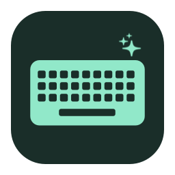
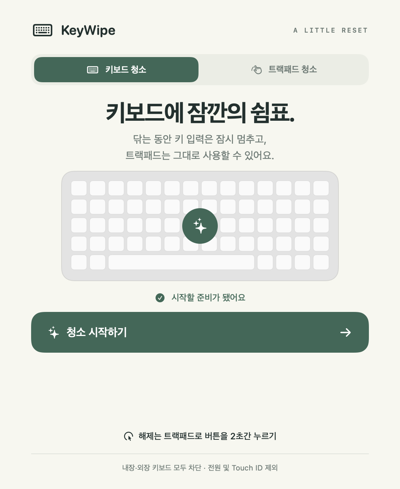
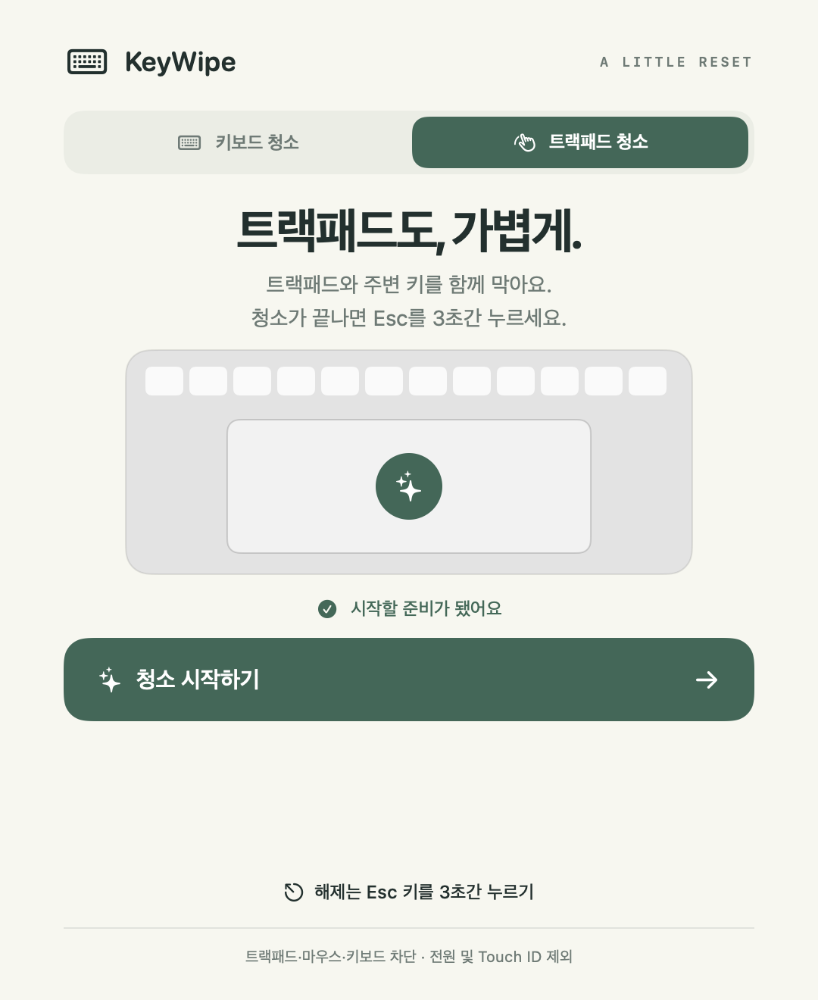

# KeyWipe

A small, native macOS app for cleaning your MacBook keyboard and trackpad without accidental input.

[한국어](README.ko.md) · [Development notes](docs/DEVELOPMENT.md) · [MIT license](LICENSE)

[](https://github.com/mir-stream/keywipe/actions/workflows/ci.yml)

| Mode | What gets blocked | How to finish |
| --- | --- | --- |
| Keyboard cleaning | Built-in and external keyboards; pointer input stays available | Hold the on-screen button for **2 seconds**, then release |
| Trackpad cleaning | Cursor movement, clicks, scrolling, gesture events, and keyboard input | Hold **Esc for 3 seconds**, then release |

Trackpad mode also blocks external mice so that nearby input cannot interrupt cleaning. Short holds cancel the unlock gesture. If a key or mouse button is still pressed, input stays blocked until it is released.

<p>
  
  
</p>

The interface is currently in Korean. The mode tabs are **키보드 청소** (keyboard) and **트랙패드 청소** (trackpad).

## Download and install

**[Download KeyWipe for macOS](https://github.com/mir-stream/keywipe/releases/latest/download/KeyWipe-macOS-universal.zip)** · [Release notes](https://github.com/mir-stream/keywipe/releases/latest)

Requires macOS 14 or later. The universal app includes both Apple Silicon and Intel binaries and is Developer ID signed and notarized by Apple.

1. Download and unzip `KeyWipe-macOS-universal.zip`.
2. Quit any running copy of KeyWipe, then move **KeyWipe.app** to **Applications**.
3. Open it and grant Accessibility permission as described below.

No Xcode or signing certificate is needed to use the release. SHA-256 checksums are provided alongside the download.

## Build from source

Requirements:

- macOS 14 or later.
- Xcode or Command Line Tools providing Swift 6 or later.
- A valid **Apple Development** code-signing identity in your keychain for the `.app` build.

```sh
git clone https://github.com/mir-stream/keywipe.git
cd keywipe
bash scripts/build.sh
open dist/KeyWipe.app
```

The build automatically selects an Apple Development identity when exactly one is available. If you have several, select one explicitly:

```sh
security find-identity -v -p codesigning
KEYWIPE_SIGNING_IDENTITY="Apple Development: Your Name (IDENTIFIER)" bash scripts/build.sh
```

Use the same signing identity and bundle identifier across builds. macOS associates privacy permissions with the app's signing identity; ad-hoc signatures change that identity on rebuild. The packaging script rejects ad-hoc signing to avoid stale Accessibility grants.

`swift test` and `swift build` do not require a signing certificate. Use the packaged `.app` for normal use so permissions belong to KeyWipe rather than your terminal. The local build uses a development identity; the downloadable release uses a distribution identity. Switching between them may require granting Accessibility permission again.

## First use

1. Click **권한 설정 열기** (Open permission settings).
2. In **System Settings → Privacy & Security → Accessibility**, enable **KeyWipe**. If it is missing, add `dist/KeyWipe.app` with the `+` button.
3. Return to KeyWipe, choose a mode, and click **청소 시작하기** (Start cleaning).
4. Finish with the 2-second button hold or the 3-second Esc hold shown above.

Grant permission at the app's final location. If Accessibility is enabled but KeyWipe still shows the permission button after changing its signing identity, remove the old KeyWipe entry and add the current app again.

Closing the home window leaves the menu-bar keyboard icon available. Quit from that icon or the app menu. The app does not start automatically at login.

## Behavior and limits

- Native Swift, SwiftUI, and AppKit; no third-party dependencies.
- Cleaning overlays appear on every connected display.
- Input contents are not recorded or sent anywhere. Only transient pressed-key/button state is kept for safe release.
- No automatic time limit. Losing permission, an event-tap interruption, sleep, or user switching ends the session. Trackpad mode also ends when the app loses foreground status.
- **Power, Touch ID, and hardware or system actions handled before event filtering are outside the blocking scope.** This is a cleaning utility, not a screen lock or security boundary.
- Secure Input must be inactive; close password-entry fields if the app cannot start.
- Gesture behavior can vary by device and macOS version. Verify the input you intend to clean on your own Mac.

## Development

```sh
swift test
swift build -c release
```

CI runs these checks on macOS without signing credentials or Accessibility permissions. Local integration probes and architecture notes are documented in [Development notes](docs/DEVELOPMENT.md).

## License

[MIT](LICENSE) © 2026 mir-stream.
